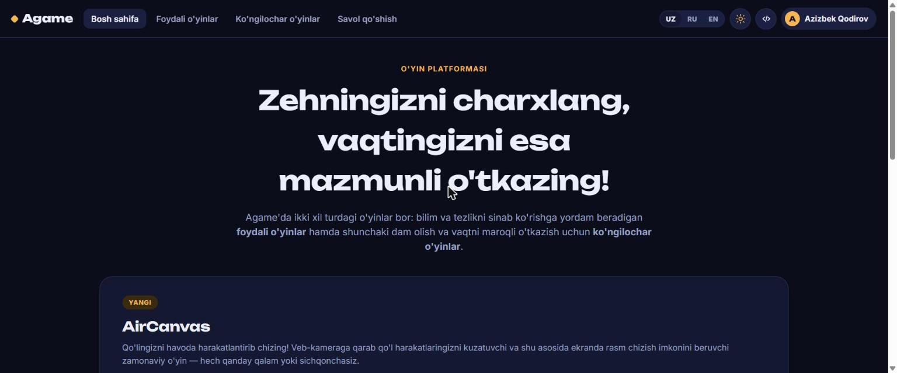

# Agame — onlayn o‘yinlar platformasi

Brauzerda to'g'ridan-to'g'ri o'ynaladigan o'yinlar platformasi. Hech narsa o'rnatish, ro'yxatdan o'tish yoki yuklab olish talab qilinmaydi — sahifani ochasiz va o'ynayverasiz.

🔗 **[agame.uz](https://agame.uz)**



## Platformada nima bor

O'yinlar ikki turkumga bo'lingan:

- **Foydali o'yinlar** — bilim va reaksiya tezligini sinaydigan o'yinlar
- **Ko'ngilochar o'yinlar** — dam olish va vaqtni maroqli o'tkazish uchun

Alohida ta'kidlash joiz bo'lgan o'yin — **AirCanvas**: veb-kamera orqali qo'l harakatlaringizni kuzatib, havoda chizish imkonini beradi. Qalam ham, sichqoncha ham kerak emas.

## Imkoniyatlar

- Uch tilli interfeys: o'zbek, rus, ingliz
- Yorug‘ va qorong‘i rejim
- Mobil qurilmalarga moslashgan dizayn
- Savol qo'shish bo'limi — foydalanuvchilar o'z savollarini yubora oladi
- SEO uchun sitemap va robots.txt sozlangan

## Texnologiyalar

Statik sayt sifatida qurilgan — backend yo‘q, shuning uchun tez ishlaydi va arzon hostlanadi.

- HTML5
- CSS3
- JavaScript

## Ishga tushirish

Loyiha oddiy statik sayt, shuning uchun istalgan statik server yetarli:

```bash
git clone https://github.com/azizbekqodirov2005/agame.git
cd agame
npx serve .
```

Yoki `index.html` faylini brauzerda to'g'ridan-to'g'ri oching.

## Muallif

**Azizbek Qodirov**

- Sayt: [azbek.uz](https://azbek.uz)
- Telegram: [@QodirovAzizbek](https://t.me/QodirovAzizbek)
